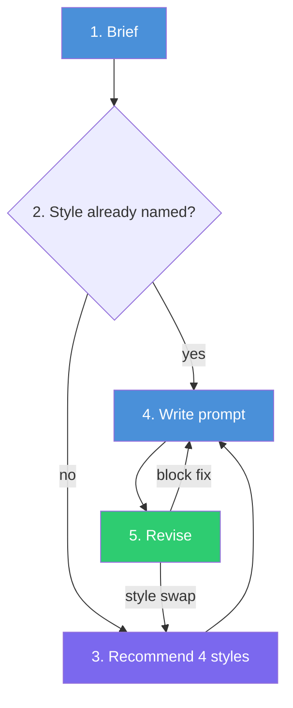

# agent-skill-image-style-prompter


**Name the style, not the vibe.** An agent skill that figures out what image you want, recommends named design styles (and two-style combinations) for it, then writes a structured prompt you can paste into any image model: GPT Image, Midjourney, Nano Banana, and others.

## Problem

Most image prompts describe a feeling: "make it clean", "make it warm", "make it pop". Another designer can guess what you mean. An image model can't. "Clean" can point at a dozen different looks, so you get the generic average.

A style name is a much sharper reference. "Utilitarian" means function-first, gridded, and a little industrial. "Wabi-Sabi" means earthy, quiet, and imperfect on purpose. One word carries a palette, a typeface mood, textures, layout habits, and signature motifs. The catch is knowing which names exist and which ones suit the image you're making.

This skill brings that vocabulary to you. It reads your request, suggests styles that fit, and turns your pick into a prompt that pins down both the content and the look.

## Features

- **54 named styles in 10 families**: Classical & Ornate, Dreamy & Ethereal, Retro-Digital, Bold & Loud, Structured & Functional, Calm & Natural, Dark & Dramatic, Handmade & Collage, Rustic & Heritage, Cute & Character. Each style lists its visual DNA, mood, best-fit image types, prompt keywords, common misfires, and good and bad pairings.
- **13 image types**: posters, UI, product shots, infographics, brand boards, photography, characters, and more. Each type knows what to ask, what to lock down, and what typically goes wrong.
- **4 spread-out recommendations**: 2 single styles and 2 combinations, drawn from different families, so you see the real range instead of four versions of one safe idea.
- **Primary + accent combinations**: the primary style sets layout and palette, the accent adds texture and motifs. The prompt spells out which element comes from which style.
- **Side-by-side comparison**: pick several options and get one prompt per style. The content blocks stay word-for-word identical, so the renders compare fairly.
- **Structured, model-agnostic prompt**: written in English, with any in-image text kept exactly as you wrote it, in its original language.
- **Targeted revisions**: feedback such as "too plain" changes only the block that causes it.

## Installation

Clone the repo into your Claude Code skills folder:

```bash
git clone https://github.com/jiangxidong/agent-skill-image-style-prompter.git ~/.claude/skills/image-style-prompter
```

The skill triggers on its own whenever you ask for an image prompt. Example requests:

- "Write a prompt for a poster about …"
- "What style should this image be?"
- "Make me a Y2K-style product shot prompt"
- "Improve this Midjourney prompt"

In Claude Code, the style options appear as a multi-select card. In other agents, they appear as a numbered list.

## Example

**Request:** "A Xiaohongshu cover for my Tokyo café-hopping collection"

**Brief.** The skill identifies the image as a poster/cover, defaults the ratio to 3:4, and asks for the title text, the main visual, and the number of cafés. You can also let it decide; here it proposed a 2×3 grid of 6 cafés with the title 「东京咖啡探店合集」 and the subtitle 「6 家私藏小店 · 附路线」.

**Recommendations**, spread across four families:

| Option | Looks like |
|---|---|
| Scrapbook (Recommended) | Polaroids taped onto kraft paper, with doodles and ticket stubs |
| Bento Box | Rounded modular tiles, tidy and calm |
| Neo-Brutalism + Rebus | Thick outlines and hard shadows, with coffee icons woven into the title |
| Japandi + Mid-Century | Oak and oat tones, with mustard accents and arched frames |

**Prompt** (Scrapbook):

```
Subject: A Xiaohongshu cover for a Tokyo café-hopping collection, showing six different specialty coffee shops as one curated set.
Composition: Title and subtitle sit in the top quarter as the strongest element; below, six café photos form a 2×3 collection, each a different café moment (latte art close-up, quiet storefront, pour-over bar, pastry with cup, window seat in morning light, tiny standing counter), mixing overhead and eye-level shots.
Style: Scrapbook — the six photos are Polaroid prints pinned slightly askew with washi tape on torn kraft paper, with hand-drawn doodles (steam swirls, arrows, small coffee cups), a train ticket stub and a few stickers between them.
Palette & Materials: Warm kraft brown, cream and faded pastels with small pops of red; torn paper edges, matte tape, white Polaroid borders, soft natural daylight on the photos.
Text: Main title "东京咖啡探店合集" in large bold hand-lettered Chinese at the top; subtitle "6 家私藏小店 · 附路线" smaller beneath it; no other text.
Format: 3:4 vertical, single finished social-media cover, high resolution.
Avoid: misspelled or garbled Chinese characters, extra text or readable shop signs and logos, a sheet of several cover drafts, messy pile with no clear focal point, scribbled illegible handwriting.
```

## How it works



1. **Brief**: pulls the subject, image type, aspect ratio, in-image text, and any reference image from your message. If something essential is missing, it asks at most 3 questions in one round.
2. **Named style?**: if you already named a style, it skips the recommendations and expands that style's DNA.
3. **Recommend**: shortlists styles from the families that fit your image type and offers 4 options spread across families.
4. **Write prompt**: fills a fixed skeleton (Subject / Composition / Style / Palette & Materials / Text / Reference / Format / Avoid), then adds up to 2 optional tweaks.
5. **Revise**: fixes only the block your feedback points at. A style swap keeps all the content blocks.

```
SKILL.md                     # workflow
references/styles.md         # the style library
references/image-types.md    # image types: what to ask, lock, and avoid
```

## Credits

- Style vocabulary inspired by Himanshu Bhardwaj, [50 Design Styles Every Designer Should Know for Better Prompting](https://uxplanet.org/50-design-styles-every-designer-should-know-for-better-prompting-56c09d55db62) (UX Planet). The style descriptions in this repo are rewritten, not quoted.
- Image-type taxonomy adapted from [freestylefly/awesome-gpt-image-2](https://github.com/freestylefly/awesome-gpt-image-2) (MIT).

## License

[MIT](LICENSE)
